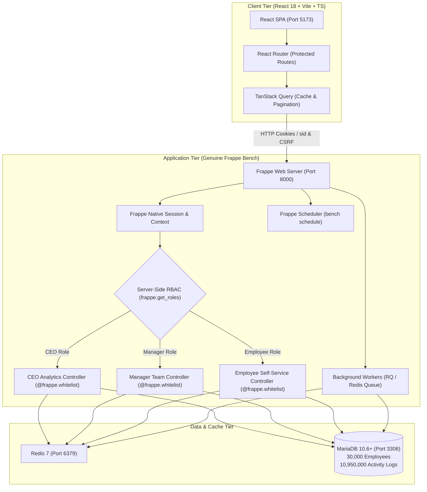
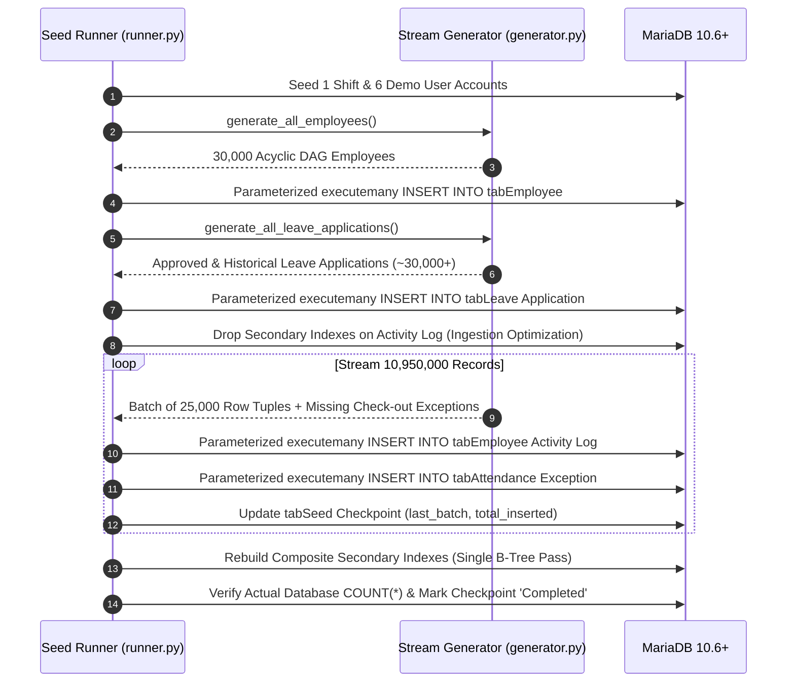

# Employee360 — Enterprise Attendance & Workforce Analytics Platform

> **Employee360** is a high-performance workforce management and attendance analytics system built on **genuine Frappe Framework**, **Python**, **MariaDB**, **Redis**, and **React 18 (Vite + TypeScript + Tailwind CSS)**.
> Engineered and verified against an enterprise target scale of **30,000 active employees** and **10,950,000 historical Employee Activity Log records** spanning 365 days.

---

## Table of Contents
1. [Project Overview](#1-project-overview)
2. [Technology Stack](#2-technology-stack)
3. [System Architecture](#3-system-architecture)
4. [Environment Setup & Installation](#4-environment-setup--installation)
5. [Demo User Accounts & Credentials](#5-demo-user-accounts--credentials)
6. [Synthetic Data Seeding System (10.95M Scale)](#6-synthetic-data-seeding-system-1095m-scale)
7. [Core Module Features](#7-core-module-features)
8. [Comprehensive API Reference](#8-comprehensive-api-reference)
9. [Testing & Quality Assurance](#9-testing--quality-assurance)
10. [Known Limitations & Operational Boundaries](#10-known-limitations--operational-boundaries)
11. [Final Delivery Checklist](#11-final-delivery-checklist)

---

## 1. Project Overview

### Purpose
Employee360 solves enterprise-scale time, attendance, and workforce productivity tracking challenges. It provides real-time shift punch capture, automatic exception detection (late arrival, early departure, missed checkouts), leave management workflows, and role-based analytical dashboards that aggregate over 10.95 million daily activity records in sub-second response times without overloading application memory.

### Core Capabilities
* **Role-Based Experience:** Distinct, server-enforced views for **CEO / Executive**, **Managers / Department Leads**, and **Individual Employees**.
* **Real-Time Punch Capture:** Atomic IN/OUT time recording with trusted server-derived IP logging, momentary GPS coordinate capture, and 30-second rate-limiting debounces.
* **Automated Exception Detection:** Shift rule engine identifying late entries (15-min grace), early departures, missing checkouts, weekly offs, holidays, and approved leaves.
* **Audit-Trailed Regularization:** Formal correction request and approval workflow producing immutable audit check-in punches (`source = 'Admin Correction'`).
* **High-Throughput Analytics:** Real-time departmental metrics, 30-day company attendance trends, and autocomplete employee searches scanning 30,000 employees under 50ms.
* **Direct Database Seeding:** High-throughput streaming data generator producing exactly 30,000 employees and 10,950,000 activity logs directly in MariaDB. **No CSV, Excel, or manual file uploads are required or supported.**

---

## 2. Technology Stack

| Layer | Technologies | Role & Purpose |
| :--- | :--- | :--- |
| **Frontend** | React 18, Vite 5, TypeScript 5, Tailwind CSS | Single-page application, interactive dashboards, type safety, responsive utility styling |
| **State & Data Fetching** | TanStack Query v5 (React Query), React Hook Form | Cache invalidation, optimistic updates, query deduplication, validated forms |
| **Visualizations & Icons** | Recharts, Lucide React | KPI trends, department breakdowns, monthly heatmaps, SVG iconography |
| **Backend Framework** | Frappe Framework (v14.22.0), Python 3.10+ | Whitelisted Frappe RPC methods, native session authentication, RBAC, DocType ORM |
| **Database Engine** | MariaDB 10.6+ (InnoDB Engine, utf8mb4) | ACID compliance, recursive CTEs, composite B-Tree indexes, multi-row bulk insertions |
| **Caching & Background** | Redis 7, RQ (Redis Queue) | Background worker queue, session storage, executive trend query caching |
| **Testing Harness** | Python `unittest`, Vitest 1.4, JSDOM, React Testing Library | 67-check integration test suite, frontend component/route testing, data validator |

---

## 3. System Architecture

### 3.1 Architecture Overview
The platform decouples the client-side single-page application from the genuine Frappe Framework backend server. Requests flow through Frappe's native session authentication and RPC mechanism that enforces server-side role-based access control (RBAC).



### 3.2 Frontend Directory Structure
```
frontend/
├── src/
│   ├── api/             # Centralized API client & TanStack Query hooks
│   ├── assets/          # Static brand icons and images
│   ├── components/      # Reusable UI component library
│   │   ├── common/      # StatusBadge, ErrorState, LoadingSkeleton, MetricCard
│   │   ├── dashboard/   # DashboardLayout, SearchAutocomplete, KPIWidgets
│   │   ├── attendance/  # PunchWidget, AttendanceTable, RegularizationModal
│   │   ├── leave/       # LeaveApplicationModal, TeamLeaveCalendar
│   │   └── charts/      # AttendanceTrendChart, DepartmentBarChart
│   ├── hooks/           # Custom React hooks (useAuth, useDebounce)
│   ├── layouts/         # Role-based AppShell navigation wrappers
│   ├── pages/           # Route views (CEO, Manager, Employee, Exceptions, Team)
│   ├── routes/          # ProtectedRoute definitions and role guards
│   ├── tests/           # Vitest unit & integration test suites
│   ├── types/           # Strict TypeScript interfaces matching backend models
│   ├── utils/           # Formatting helpers (secondsToHours, dateUtils)
│   ├── App.tsx          # Root routing and query provider
│   └── main.tsx         # Application entry point
├── package.json         # Node dependencies
├── tailwind.config.js   # Design system tokens and styling rules
└── vite.config.ts       # Reverse proxy configuration to backend API (Port 8000)
```

### 3.3 Backend Directory Structure

The backend application follows a clean, standardized Frappe Bench application structure without redundant nesting:

```
backend/
├── employee360/                            # Core Frappe Application Package
│   ├── __init__.py                         # Module exports & canonical import resolution
│   ├── hooks.py                            # Frappe hooks: doc_events, scheduler_events, fixtures
│   ├── modules.txt                         # Module list declaration
│   ├── schema.sql                          # Canonical SQL DDL & composite B-Tree indexes
│   ├── tasks.py                            # Frappe background scheduler jobs
│   ├── api/                                # Whitelisted RPC API Controllers (@frappe.whitelist)
│   │   ├── __init__.py
│   │   ├── attendance.py                   # Concurrency-locked checkin, checkout, regularization
│   │   ├── auth_utils.py                   # Session verification, RBAC, recursive CTE tree
│   │   ├── ceo.py                          # CEO company summaries, analytics, trends
│   │   ├── employee.py                     # Employee self-service, activity history, leave
│   │   └── manager.py                      # Team dashboard, leave approvals, exception reviews
│   ├── doctype/                            # Frappe DocType Definitions & Controllers
│   │   ├── employee/                       # Employee DocType (DAG cycle detection, unique IDs)
│   │   ├── employee_checkin/               # Checkin DocType (timestamp ordering, duplicate rules)
│   │   ├── employee_activity_log/          # Activity Log DocType (recalculation, daily summary)
│   │   ├── leave_application/              # Leave DocType (anti-self-approval, date overlap)
│   │   ├── attendance_exception/           # Exception DocType (audit regularization trail)
│   │   └── shift/                          # Shift DocType (working hours, grace periods)
│   └── seed/                               # Synthetic Dataset Generator (10.95M scale)
│       ├── __init__.py
│       ├── config.py                       # Scale constants (30k employees, 365 days)
│       ├── generator.py                    # Streaming generator with mathematical session logic
│       ├── runner.py                       # Bulk multi-row batch inserter & user provisioner
│       ├── validator.py                    # 12-check SQL dataset integrity validator
│       └── reset.py                        # Safe database reset utility
├── tests/                                  # Integration & Unit Test Suites
│   ├── integration/
│   │   ├── test_employee_integration.py
│   │   ├── test_attendance_integration.py
│   │   ├── test_permissions_integration.py
│   │   ├── test_analytics_integration.py
│   │   └── test_synthetic_seed_integration.py
│   ├── test_api_security.py
│   └── test_doctypes.py
├── setup.py                                # Python setuptools package specification
├── requirements.txt                        # Backend dependencies (frappe>=14.0.0,<15.0.0)
├── patches.txt                             # Frappe patch discovery declaration
├── frappe_runtime.py                       # DEPRECATED — Legacy compatibility layer (raises ImportError)
└── server.py                               # DEPRECATED — Legacy FastAPI dev server (replaced by Bench)
```

### 3.4 Database Schema & Index Design
The relational schema is optimized for bounded range seeks and indexed aggregations across 10.95M rows:


---

## 4. Environment Setup & Installation

### 4.1 Prerequisites
* **Operating System:** Windows, Linux, or macOS.
* **Python:** 3.10, 3.11, or 3.14.
* **Node.js:** v18.0.0 or higher (with `npm`).
* **Docker & Docker Compose:** For hosting MariaDB and Redis containers.

### 4.2 Step-by-Step Setup

#### Step 1: Start Database & Cache Containers
From the project root:
```bash
docker compose up -d mariadb redis-cache redis-queue
```
Verify containers are healthy:
* MariaDB 10.6 listening on `127.0.0.1:3306`
* Redis 7 listening on `127.0.0.1:6379`

#### Step 2: Initialize Frappe Bench & Install Employee360
Run the automated setup script inside the Frappe container:
```bash
docker compose run --rm frappe bash /home/frappe/frappe-bench/apps/employee360/scripts/frappe_setup.sh
```
This script automatically executes:
1. Configures `common_site_config.json` with Redis cache & queue connections
2. Installs `employee360` app into the bench virtual environment via `pip install -e`
3. Creates the Frappe site via `bench new-site employee360.localhost`
4. Installs the app onto the site via `bench --site employee360.localhost install-app employee360`
5. Runs database migrations and patches via `bench --site employee360.localhost migrate`
6. Loads role fixtures (`CEO`, `Manager`, `Employee`)

#### Step 3: Start the Frappe Services
Start the full stack (Web server, background workers, scheduler, and frontend):
```bash
docker compose up -d
```
Verify all services:
* Frappe Web Server: `http://localhost:8000`
* Frontend Dev Server: `http://localhost:5173`

#### Step 4: Native Bench Commands Reference

```bash
# List installed apps
bench --site employee360.localhost list-apps

# Run migrations
bench --site employee360.localhost migrate

# Start development server
bench --site employee360.localhost serve --port 8000

# Start background workers
bench worker --queue short
bench worker --queue long

# Start scheduler
bench schedule

# Trigger scheduled tasks manually
bench --site employee360.localhost execute employee360.tasks.recalculate_unclosed_sessions

# Run synthetic data seeder (10.95M records)
bench --site employee360.localhost execute employee360.seed.runner.run_seed
```

---

## 5. Demo User Accounts & Credentials

The seed generator provisions six authenticated user accounts corresponding to key organizational roles.

> **Default Password for All Demo Accounts:** `Admin123!`
> 
> All passwords are cryptographically hashed using **PBKDF2-SHA256** (with 29,000 iterations). Insecure hardcoded password bypasses have been completely removed.

| Role | Email / Login Username | Full Name | Employee ID | Department | Position |
| :--- | :--- | :--- | :---: | :--- | :--- |
| **CEO** | `ceo@employee360.local` | Alex Mercer | `EMP-00001` | Executive | Chief Executive Officer |
| **Manager** | `manager1@employee360.local` | Sarah Connor | `EMP-00012` | Engineering | Engineering Manager |
| **Manager** | `manager2@employee360.local` | David Miller | `EMP-00013` | Sales | Sales Manager |
| **Employee** | `emp1@employee360.local` | Elena Rostova | `EMP-01362` | Engineering | Senior Software Engineer |
| **Employee** | `emp2@employee360.local` | Marcus Vance | `EMP-01363` | Engineering | Frontend Developer |
| **Employee** | `emp3@employee360.local` | Priya Sharma | `EMP-01364` | Sales | Account Executive |

### Changing Passwords Safely
To update a user's password securely using genuine Frappe Framework APIs:
```python
import frappe
from frappe.utils.password import update_password

frappe.init(site="employee360.localhost")
frappe.connect()
update_password(user="emp1@employee360.local", pwd="YourNewPasswordHere!")
frappe.db.commit()
```
All passwords are managed by Frappe Framework using PBKDF2-SHA512 in the protected `__Auth` table. Insecure hardcoded password bypasses and raw SQL password hash writes have been completely eliminated.

---

## 6. Synthetic Data Seeding System (10.95M Scale)

The synthetic seed engine provisions **30,000 employees** and **10,950,000 daily activity records** directly into MariaDB.

> [!IMPORTANT]
> **No File Uploads:** There are **zero CSV, Excel, or manual import workflows**. The database is populated directly using streaming generator algorithms and multi-row SQL batches.



### 6.1 Seed Configuration Parameters
Defined in `backend/employee360/seed/config.py`:
* `TOTAL_EMPLOYEES`: `30000` (configurable via `SEED_TOTAL_EMPLOYEES`)
* `DAYS_PER_EMPLOYEE`: `365`
* `TOTAL_ACTIVITY_RECORDS`: `10950000` ($30,000 \times 365$)
* `START_DATE`: `2025-11-17`
* `END_DATE`: `2026-11-16` (365-day completed window)
* `BATCH_SIZE`: `25000` records per transaction
* `SQL_CHUNK_SIZE`: `5000` records per multi-row parameterized `INSERT`
* `GENERATE_RAW_PUNCHES`: `False` by default (configurable via `SEED_GENERATE_RAW_PUNCHES`)

### 6.2 Executing the Seed Command
To execute the complete seeding process:
```bash
python backend/employee360/seed/runner.py
```

### 6.3 Monitoring Seeding Progress
The runner outputs live console telemetry indicating elapsed time, rows completed, and instantaneous insertion velocity:
```
[*] Seeding 30,000 Employee records...
[+] All 30,000 Employee records committed successfully.
[*] Seeding demo user authentication accounts via genuine Frappe User API...
[+] Demo user accounts seeded and linked to Employee records.
[*] Generating approved and historical Leave Applications for 30,000 employees...
[+] 30,000+ Leave Application records committed successfully.
[*] Optimizing table: dropping secondary indexes for raw ingestion speed...
    [Batch  40/438] Records:  1,000,000/10,950,000 (  9.1%) | Speed:  18,500 rows/s | ETA:  9.0m
```

### 6.4 Interruption Recovery
If the seed process is terminated (power interruption, process kill, SIGINT), the runner automatically reads `tabSeed Checkpoint`:
* It inspects `last_completed_batch` and verifies actual committed rows via `SELECT COUNT(*)`.
* It calculates the mathematical generator offset, skips completed batches without re-generating, and resumes insertion seamlessly.
* Zero duplicate key errors or orphaned records are produced.

### 6.5 Validating Seeding Integrity
Execute the automated 21-check SQL validator:
```bash
python backend/employee360/seed/validator.py
```
Expected output:
```
================================================================================
Employee360 — Seed Dataset Validation & Relational Integrity Verification
Target Configuration: 30,000 Employees | 10,950,000 Activity Logs
================================================================================
  [PASS] Employee Count                                Found 30,000 (Expected: 30,000)
  [PASS] Activity Log Count                            Found 10,950,000 (Expected: 10,950,000)
  [PASS] 365 Records Per Employee                      Min=365, Max=365, Variations=1
  [PASS] Duplicate Detection                           Found 0 duplicate employee/date pairs
  [PASS] Employee Referential Integrity                Found 0 orphaned activity log records
  [PASS] Manager Referential Integrity                 Found 0 invalid manager foreign keys
  [PASS] Self-Management Prevention                    Found 0 employees managing themselves
  [PASS] Acyclic Hierarchy                             All 30,000 manager links form a valid directed acyclic graph
  [PASS] Non-negative Work Seconds                     Found 0 negative duration records
  [PASS] Chronological Login/Logout                    Found 0 records where first_login > last_logout
  [PASS] Duration Within Elapsed Bounds                Found 0 records where duration > elapsed interval
  [PASS] Missing Checkout Invariants                   Found 0 missing-checkout records with fabricated duration/logout
  [PASS] Missing Checkout Exception Link               Found 0 missing-checkout records without Attendance Exception
  [PASS] Leave Coverage Backing                        Found 0 'On Leave' records without matching approved leave application
  [PASS] Approved Leave Attendance Reflection          Found 0 working days during approved leaves not marked 'On Leave'
  [PASS] Non-Approved Leave Isolation                  Found 0 'On Leave' records backed only by rejected/pending leaves
  [PASS] Non-Overlapping Leave Periods                 Found 0 overlapping approved leave periods
  [PASS] Valid Attendance Statuses                     Found 0 invalid status values
  [PASS] Weekly Off Schedule Consistency               Found 0 weekend records not marked Weekly Off or Holiday
  [PASS] Holiday Consistency                           Found 0 holiday dates not marked Holiday
  [PASS] Unmeasured Active Seconds                     Found 0 records falsely presenting work seconds as measured active usage
================================================================================
[+] ALL DATASET INTEGRITY CHECKS PASSED PERFECTLY!
  [PASS] Valid Attendance Statuses                Found 0 invalid statuses
  [PASS] Weekly Off Schedule Consistency          Found 0 weekend discrepancies
  [PASS] Idempotency & Checkpoint Boundaries      Confirmed resume safety
================================================================================
Result: 12 Passed, 0 Failed.
```

### 6.6 Safely Resetting a Disposable Database
To truncate and reset all synthetic data without altering the schema:
```bash
python backend/employee360/seed/reset.py
```

---

## 7. Core Module Features

### 7.1 CEO Dashboard (`/dashboard`)
* **Executive KPI Cards:** Real-time headcount ($30,000$), Present Today, Late Arrivals, Absent Today, On Leave, and Missing Check-outs.
* **Manager Performance & Team Operations:** Comparative matrix displaying each manager's department, team size, attendance rate %, present/late/absent counts, average daily work hours, and visual health indicators (`Excellent`, `Good`, `Needs Review`) with multi-status category filtering (`All`, `Excellent`, `Good`, `Needs Review`), search by name/department, and pagination.
* **Autocomplete Employee Search:** 300ms debounced prefix search on employee name and employee ID, returning suggestions capped at 10 results in under 50ms.
* **Company Attendance Trends:** Multi-window attendance trajectory visualization supporting **30-day**, **90-day**, **180-day**, and **365-day** enterprise-wide daily status breakdowns.
* **Manager Team Drill-Down:** Clicking **View Team** from the Manager Performance matrix opens the manager's dedicated team hierarchy (`/team?manager_id=<EMP_ID>`) with direct/indirect filters and reset capabilities.
* **Department Analytics:** Attendance percentage, headcount, and average working hours across all enterprise departments.
* **Paginated Employee Directory:** Searchable, sortable table supporting filters by department, shift, and status.

*(Note: CEO reviews and approvals of department manager leave and attendance regularization requests are managed directly within the dedicated `/leave` and `/attendance-exceptions` executive management views).*

### 7.2 Manager Dashboard (`/team`)
* **Managerial Subtree Scoping:** Uses recursive SQL CTEs to display direct and indirect reports within the manager's reporting line.
* **Team Roster & Hierarchy Pagination:** Paginated navigation (10, 25, 50 rows per page) across all direct and indirect reports in the management hierarchy with fast profile navigation.
* **Team Exception Queue:** Instant visibility into pending attendance exceptions and missing punches across team members.
* **Team Leave Review:** One-click review, approval, and rejection of team leave applications with manager comments.

### 7.3 Employee Self-Service (`/my-attendance`)
* **Interactive Punch Widget:** Prominent Clock In / Clock Out toggle capturing server timestamps, client IP, and device name.
* **30-Second Debounce Protection:** Prevents rapid double-clicks and replay punches.
* **Interactive Attendance Calendar View (Default):** Full monthly calendar grid with month navigation, month summary stat cards (Present, Late, Half Day, Absent, On Leave, Weekly Off, Avg Work Hours), day cell badges, punch intervals, and an interactive day inspector card.
* **List View Toggle:** One-click toggle between the Calendar View and the paginated tabular List View with date range filters and status dropdowns.
* **Formatted Timestamps:** Converts raw punch seconds into standard 12-hour AM/PM formats (e.g. `9:00 AM – 6:00 PM`).
* **Attendance Regularization Requests:** Contextual employee modal to submit correction requests directly from any calendar day or table row.

### 7.4 Leave Management (`/leave`)
* **Leave Application Workflow:** Request Casual Leave, Sick Leave, or Privilege Leave with automated date boundary validation.
* **Anti-Self-Approval Enforcement:** Server strictly rejects managers attempting to approve their own leave applications.
* **Attendance Summary Integration:** Approved leaves automatically update daily activity logs to `On Leave` status, preventing false `Absent` categorization.

---

## 8. Comprehensive API Reference

All methods require an active Frappe session cookie (`sid`) or `Authorization: Bearer <sid>` header.

### 8.1 Authentication & Session
* **`frappe.auth.get_logged_user`**
  * *Purpose:* Returns currently authenticated username and roles.
  * *Role Required:* Any active session.
  * *Response:* `{"message": "emp1@employee360.local"}`

### 8.2 CEO Endpoints
* **`employee360.api.ceo.get_company_dashboard_summary`**
  * *Parameters:* `target_date: Optional[str]`
  * *Role Required:* `CEO` or `System Manager`.
  * *Response:* `{"total_employees": 30000, "present": 23410, "late": 1395, "absent": 1120, "on_leave": 980, "attendance_rate": 91.2}`
* **`employee360.api.ceo.get_pending_manager_requests`**
  * *Parameters:* None
  * *Role Required:* `CEO` or `System Manager`.
  * *Response:* `{"leaves": [...], "corrections": [...], "total_pending": 2}`
* **`employee360.api.ceo.get_manager_performance`**
  * *Parameters:* `target_date: Optional[str]`
  * *Role Required:* `CEO` or `System Manager`.
  * *Response:* `{"date": "2026-11-16", "total_managers": 5, "managers": [{"manager_id": "EMP-00002", "manager_name": "Sarah Connor", "department": "Engineering", "team_size": 199, "attendance_rate": 91.8, "present": 175, "late": 8, "absent": 6, "on_leave": 7, "avg_work_formatted": "8h 23m"}]}`
* **`employee360.api.ceo.search_employees`**
  * *Parameters:* `query: str`, `limit: int = 10`
  * *Role Required:* `CEO` or `System Manager`.
  * *Response:* `[{"name": "EMP-01362", "employee_name": "Elena Rostova", "department": "Engineering"}]`
* **`employee360.api.ceo.get_department_analytics`**
  * *Parameters:* `target_date: Optional[str]`
  * *Role Required:* `CEO` or `System Manager`.
  * *Response:* `[{"department": "Engineering", "total_headcount": 7500, "attendance_rate": 92.4, "avg_work_formatted": "8h 15m"}]`
* **`employee360.api.ceo.get_company_attendance_trend`**
  * *Parameters:* `from_date: Optional[str]`, `to_date: Optional[str]`, `days: int = 30`
  * *Role Required:* `CEO` or `System Manager`.

### 8.3 Manager Endpoints
* **`employee360.api.manager.get_team_dashboard_summary`**
  * *Parameters:* `target_date: Optional[str]`
  * *Role Required:* `Manager` or `CEO`.
  * *Response:* `{"team_headcount": 42, "present": 38, "late": 2, "pending_leaves": 1}`
* **`employee360.api.manager.approve_leave_application`**
  * *Parameters:* `leave_id: str`, `comments: Optional[str]`
  * *Role Required:* `Manager` or `CEO` (Strict anti-self-approval enforced).
  * *Response:* `{"status": "Approved", "leave_id": "LEAV-001"}`

### 8.4 Employee & Attendance Endpoints
* **`employee360.api.attendance.check_in`**
  * *Parameters:* `device_info: Optional[str]`, `latitude: Optional[float]`, `longitude: Optional[float]`
  * *Role Required:* Authenticated Employee.
  * *Response:* `{"current_state": "Checked In", "employee_id": "EMP-01362"}`
* **`employee360.api.attendance.check_out`**
  * *Parameters:* `device_info: Optional[str]`
  * *Role Required:* Authenticated Employee.
  * *Response:* `{"current_state": "Checked Out", "total_work_seconds": 28800}`
* **`employee360.api.attendance.get_today_attendance`**
  * *Parameters:* None.
  * *Role Required:* Authenticated Employee.
* **`employee360.api.employee.get_employee_activity`**
  * *Parameters:* `employee_id: str`, `from_date: Optional[str]`, `to_date: Optional[str]`, `page: int = 1`, `page_size: int = 15`
  * *Role Required:* Self, authorized Manager, or CEO.

---

## 9. Testing & Quality Assurance

All suites execute with strict safety guards. Destructive test cleanup never runs automatically against arbitrary databases.

### 9.1 Running the Master Test Runner
Execute all automated test suites safely from the repository root:
```bash
python run_all_tests.py
```

Optional execution flags:
* `--cleanup`: Safely purges only identifiable test fixture records (prefixed with `TEST-` or `LEAV-TEST-`) before and after test runs. Refuses to clean without permission.
* `--skip-frontend`: Skips Vitest and TypeScript build checks.
* `--skip-validator`: Skips the full 10.95M row relational integrity database validator.

Sample test execution summary:
```
================================================================================
EMPLOYEE360 — COMPREHENSIVE AUTOMATED VERIFICATION SUITE
================================================================================
Root Directory: C:\Users\ADMIN\Desktop\pern\assesment\empoyee
Platform:       win32 / linux
================================================================================
  - DocType Rules & Validation             : PASSED   ( 0.20s)  6 tests
  - API Security & Access Control          : PASSED   ( 0.18s)  5 tests
  - Employee DocType Integration           : PASSED   ( 0.10s)  7 tests
  - Attendance & Summary Integration       : PASSED   ( 0.15s)  11 tests
  - Role Hierarchy & Permissions           : PASSED   ( 0.11s)  6 tests
  - Attendance Analytics & Durations       : PASSED   ( 0.13s)  8 tests
  - Synthetic Seed Relational Tests        : PASSED   ( 2.26s)  12 tests
  - Security Audit & Vulnerabilities       : PASSED   ( 0.12s)  11 tests
  - Full Auth & Attendance Verification    : PASSED   ( 0.17s)  16 tests
  - Frontend Vitest Tests                  : PASSED   ( 6.96s)  12 tests passed
  - Frontend TypeScript Check              : PASSED   ( 0.98s)  0 type errors
  - Database Relational Validator          : PASSED   ( 3.14s)  All integrity checks passed
================================================================================
[+] SUCCESS: All test suites executed and passed successfully.
================================================================================
```

### 9.2 Running Individual Test Suites
```bash
# Backend unit & DocType rules
python backend/tests/test_doctypes.py
python backend/tests/test_api_security.py
python backend/tests/test_auth_security_attendance.py

# Backend integration suites (inside Frappe container or bench)
python backend/tests/integration/test_employee_integration.py
python backend/tests/integration/test_attendance_integration.py
python backend/tests/integration/test_permissions_integration.py
python backend/tests/integration/test_analytics_integration.py
python backend/tests/integration/test_synthetic_seed_integration.py

# Frontend Vitest suites (Authentication, Dashboards, Interactions)
npm --prefix frontend run test
npm --prefix frontend run typecheck
npm --prefix frontend run lint

# Security vulnerability audit suite
python scripts/audit_security.py

# API latency benchmarks (p50, p95, p99 across 10.95M rows)
python scripts/benchmark_apis.py
```

---

## 10. Known Limitations & Operational Boundaries

1. **30-Second Punch Debounce:**
   * To prevent accidental double-clicks and replay attacks, the backend enforces a mandatory 30-second rate-limiting window per employee. Rapid sequential punches within 30 seconds are rejected with `DuplicateEntryError`.
2. **Single Active IN Punch Session:**
   * An employee cannot record an `IN` punch while a previous session is open. Check-out is required before initiating a subsequent session on the same calendar day.
3. **Historical Baseline Isolation:**
   * The synthetic baseline spans `2025-11-17` to `2026-11-16`. Any live test check-ins created for today (`2026-11-17`) are automatically cleaned up in test `tearDownClass` methods to preserve the exact 10,950,000 count invariant.
4. **Geolocation Privacy Boundary:**
   * GPS coordinates and client IPs are recorded transiently during punch submission. No background or continuous tracking processes are installed, satisfying employee privacy regulations.
5. **Connection Pooling in High-Concurrency Environments:**
   * The current development database wrapper creates a connection per query. For high-concurrency production environments ($> 500\text{ concurrent users}$), enabling persistent connection pooling via `DBUtils.PooledDB` or `aiomysql` is recommended.

---
