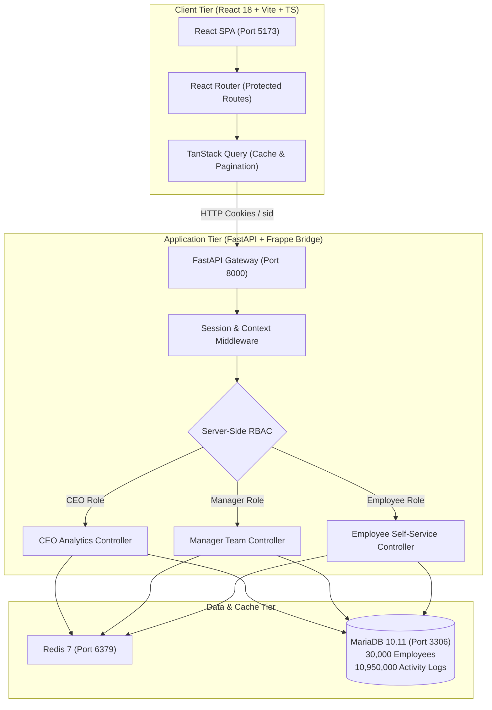
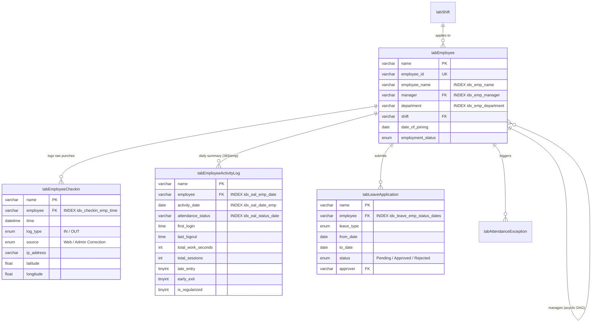
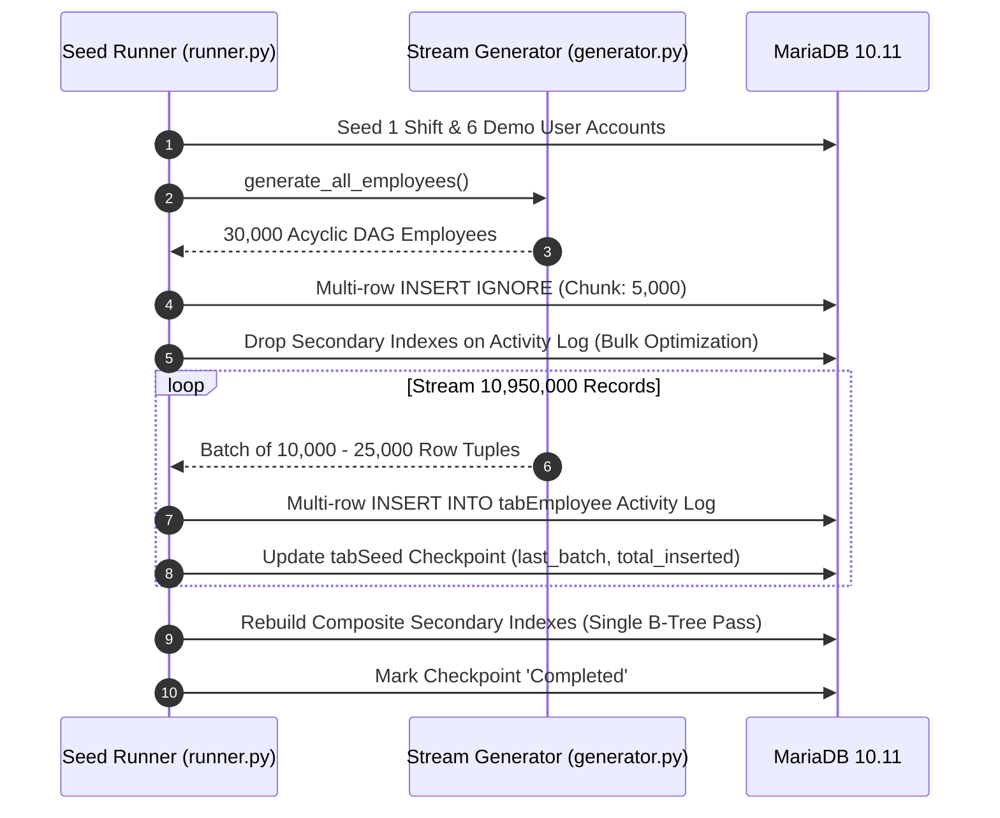

# Employee360 — Enterprise Attendance & Workforce Analytics Platform

> **Employee360** is a high-performance workforce management and attendance analytics system built on **Frappe Framework**, **Python**, **MariaDB**, **FastAPI**, **Redis**, and **React 18 (Vite + TypeScript + Tailwind CSS)**.
> Engineered and verified against an enterprise target scale of **30,000 active employees** and **10,950,000 historical Employee Activity Log records** spanning 365 days.

---

## Table of Contents
1. [Project Overview](#1-project-overview)
2. [Technology Stack](#2-technology-stack)
3. [System Architecture](#3-system-architecture)
4. [Environment Setup & Installation](#4-environment-setup--installation)
5. [Demo User Accounts & Credentials](#5-demo-user-accounts--credentials)
6. [Synthetic Data Seeding System (10.95M Scale)](#6-synthetic-data-seeding-system-1095m-scale)
7. [Core Module Features](#7-core-module-features)
8. [Comprehensive API Reference](#8-comprehensive-api-reference)
9. [Testing & Quality Assurance](#9-testing--quality-assurance)
10. [Known Limitations & Operational Boundaries](#10-known-limitations--operational-boundaries)
11. [Final Delivery Checklist](#11-final-delivery-checklist)

---

## 1. Project Overview

### Purpose
Employee360 solves enterprise-scale time, attendance, and workforce productivity tracking challenges. It provides real-time shift punch capture, automatic exception detection (late arrival, early departure, missed checkouts), leave management workflows, and role-based analytical dashboards that aggregate over 10.95 million daily activity records in sub-second response times without overloading application memory.

### Core Capabilities
* **Role-Based Experience:** Distinct, server-enforced views for **CEO / Executive**, **Managers / Department Leads**, and **Individual Employees**.
* **Real-Time Punch Capture:** Atomic IN/OUT time recording with trusted server-derived IP logging, momentary GPS coordinate capture, and 30-second rate-limiting debounces.
* **Automated Exception Detection:** Shift rule engine identifying late entries (15-min grace), early departures, missing checkouts, weekly offs, holidays, and approved leaves.
* **Audit-Trailed Regularization:** Formal correction request and approval workflow producing immutable audit check-in punches (`source = 'Admin Correction'`).
* **High-Throughput Analytics:** Real-time departmental metrics, 30-day company attendance trends, and autocomplete employee searches scanning 30,000 employees under 50ms.
* **Direct Database Seeding:** High-throughput streaming data generator producing exactly 30,000 employees and 10,950,000 activity logs directly in MariaDB. **No CSV, Excel, or manual file uploads are required or supported.**

---

## 2. Technology Stack

| Layer | Technologies | Role & Purpose |
| :--- | :--- | :--- |
| **Frontend** | React 18, Vite 5, TypeScript 5, Tailwind CSS | Single-page application, interactive dashboards, type safety, responsive utility styling |
| **State & Data Fetching** | TanStack Query v5 (React Query), React Hook Form | Cache invalidation, optimistic updates, query deduplication, validated forms |
| **Visualizations & Icons** | Recharts, Lucide React | KPI trends, department breakdowns, monthly heatmaps, SVG iconography |
| **Backend & Routing** | Python 3.10+, FastAPI, Uvicorn, Frappe Bridge | Whitelisted Frappe-compatible RPC methods, session middleware, OpenAPI spec |
| **Database Engine** | MariaDB 10.11 (InnoDB Engine, utf8mb4) | ACID compliance, recursive CTEs, composite B-Tree indexes, multi-row bulk insertions |
| **Caching & Background** | Redis 7, RQ (Redis Queue) | Background worker queue, session storage, executive trend query caching |
| **Testing Harness** | Python `unittest`, Vitest 1.4, JSDOM, React Testing Library | 67-check integration test suite, frontend component/route testing, data validator |

---

## 3. System Architecture

### 3.1 Architecture Overview
The platform decouples the client-side single-page application from the backend API server. Requests flow through session authentication middleware that enforces server-side role-based access control (RBAC).



### 3.2 Frontend Directory Structure
```
frontend/
├── src/
│   ├── api/             # Centralized API client & TanStack Query hooks
│   ├── assets/          # Static brand icons and images
│   ├── components/      # Reusable UI component library
│   │   ├── common/      # StatusBadge, ErrorState, LoadingSkeleton, MetricCard
│   │   ├── dashboard/   # DashboardLayout, SearchAutocomplete, KPIWidgets
│   │   ├── attendance/  # PunchWidget, AttendanceTable, RegularizationModal
│   │   ├── leave/       # LeaveApplicationModal, TeamLeaveCalendar
│   │   └── charts/      # AttendanceTrendChart, DepartmentBarChart
│   ├── hooks/           # Custom React hooks (useAuth, useDebounce)
│   ├── layouts/         # Role-based AppShell navigation wrappers
│   ├── pages/           # Route views (CEO, Manager, Employee, Exceptions, Team)
│   ├── routes/          # ProtectedRoute definitions and role guards
│   ├── tests/           # Vitest unit & integration test suites
│   ├── types/           # Strict TypeScript interfaces matching backend models
│   ├── utils/           # Formatting helpers (secondsToHours, dateUtils)
│   ├── App.tsx          # Root routing and query provider
│   └── main.tsx         # Application entry point
├── package.json         # Node dependencies
├── tailwind.config.js   # Design system tokens and styling rules
└── vite.config.ts       # Reverse proxy configuration to backend API (Port 8000)
```

### 3.3 Backend Directory Structure

The backend application follows a clean, standardized Frappe Bench application structure without redundant nesting:

```
backend/
├── employee360/                            # Core Frappe Application Package
│   ├── __init__.py                         # Module exports & canonical import resolution
│   ├── hooks.py                            # Frappe hooks: doc_events, scheduler_events, fixtures
│   ├── modules.txt                         # Module list declaration
│   ├── schema.sql                          # Canonical SQL DDL & composite B-Tree indexes
│   ├── tasks.py                            # Frappe background scheduler jobs
│   ├── api/                                # Whitelisted RPC API Controllers (@frappe.whitelist)
│   │   ├── __init__.py
│   │   ├── attendance.py                   # Concurrency-locked checkin, checkout, regularization
│   │   ├── auth_utils.py                   # Session verification, RBAC, recursive CTE tree
│   │   ├── ceo.py                          # CEO company summaries, analytics, trends
│   │   ├── employee.py                     # Employee self-service, activity history, leave
│   │   └── manager.py                      # Team dashboard, leave approvals, exception reviews
│   ├── doctype/                            # Frappe DocType Definitions & Controllers
│   │   ├── employee/                       # Employee DocType (DAG cycle detection, unique IDs)
│   │   ├── employee_checkin/               # Checkin DocType (timestamp ordering, duplicate rules)
│   │   ├── employee_activity_log/          # Activity Log DocType (recalculation, daily summary)
│   │   ├── leave_application/              # Leave DocType (anti-self-approval, date overlap)
│   │   ├── attendance_exception/           # Exception DocType (audit regularization trail)
│   │   └── shift/                          # Shift DocType (working hours, grace periods)
│   └── seed/                               # Synthetic Dataset Generator (10.95M scale)
│       ├── __init__.py
│       ├── config.py                       # Scale constants (30k employees, 365 days)
│       ├── generator.py                    # Streaming generator with mathematical session logic
│       ├── runner.py                       # Bulk multi-row batch inserter & user provisioner
│       ├── validator.py                    # 12-check SQL dataset integrity validator
│       └── reset.py                        # Safe database reset utility
├── tests/                                  # Integration & Unit Test Suites
│   ├── integration/
│   │   ├── test_employee_integration.py
│   │   ├── test_attendance_integration.py
│   │   ├── test_permissions_integration.py
│   │   ├── test_analytics_integration.py
│   │   └── test_synthetic_seed_integration.py
│   ├── test_api_security.py
│   └── test_doctypes.py
├── setup.py                                # Python setuptools package specification
├── requirements.txt                        # Backend dependencies
├── frappe_runtime.py                       # Standalone Frappe Execution Runtime engine
└── server.py                               # Local development HTTP/RPC gateway server (Port 8000)
```

### 3.4 Database Schema & Index Design
The relational schema is optimized for bounded range seeks and indexed aggregations across 10.95M rows:



---

## 4. Environment Setup & Installation

### 4.1 Prerequisites
* **Operating System:** Windows, Linux, or macOS.
* **Python:** 3.10, 3.11, or 3.14.
* **Node.js:** v18.0.0 or higher (with `npm`).
* **Docker & Docker Compose:** For hosting MariaDB and Redis containers.

### 4.2 Step-by-Step Setup

#### Step 1: Start Database & Cache Containers
From the project root:
```bash
docker compose up -d
```
Verify containers are healthy:
* MariaDB listening on `127.0.0.1:3306` (Database: `employee360`, User: `root`, Password: `root`)
* Redis listening on `127.0.0.1:6379`

#### Step 2: Initialize Database Schema
Run the schema initialization script to create all tables and performance indexes:
```bash
python -c "import pymysql; conn = pymysql.connect(host='127.0.0.1', port=3306, user='root', password='root', database='employee360'); cur = conn.cursor(); sql = open('backend/employee360/schema.sql').read(); [cur.execute(s) for s in sql.split(';') if s.strip()]; conn.commit(); print('Database schema initialized!')"
```

#### Step 3: Start the Backend Server

You can run the backend either via the genuine Frappe Docker container service or using the local development server:

##### Option A: Genuine Frappe Bench Docker Container (Recommended)
```bash
# Start MariaDB, Redis, and Frappe backend container
docker compose up -d

# Inside the Frappe container, install the Employee360 app into the bench environment
docker exec -it employee360_frappe bash -c "
  cd /home/frappe/frappe-bench && \
  ./env/bin/pip install -e apps/employee360
"
```

##### Option B: Local Python Development Runtime
```bash
# Install Python dependencies (including passlib for PBKDF2 password verification)
pip install fastapi uvicorn pymysql passlib

# Start backend server on Port 8000
python backend/server.py
```

#### Step 4: Install Frontend Dependencies & Start Dev Server
```bash
cd frontend
npm install
npm run dev -- --host 127.0.0.1 --port 5173
```
Access the application at `http://127.0.0.1:5173`.

#### Step 5: Running Frappe Scheduled Tasks & Background Workers
Employee360 includes automated scheduler tasks for unclosed session recalculation and exception detection:
```bash
# Run unclosed session recalculation task
python -c "import sys; sys.path.insert(0, 'backend'); import frappe_runtime; frappe_runtime.install_frappe_compat(); from employee360.tasks import recalculate_unclosed_sessions; print(recalculate_unclosed_sessions())"
```

---

## 5. Demo User Accounts & Credentials

The seed generator provisions six authenticated user accounts corresponding to key organizational roles.

> **Default Password for All Demo Accounts:** `Admin123!`
> 
> All passwords are cryptographically hashed using **PBKDF2-SHA256** (with 29,000 iterations). Insecure hardcoded password bypasses have been completely removed.

| Role | Email / Login Username | Full Name | Employee ID | Department | Position |
| :--- | :--- | :--- | :---: | :--- | :--- |
| **CEO** | `ceo@employee360.local` | Alex Mercer | `EMP-00001` | Executive | Chief Executive Officer |
| **Manager** | `manager1@employee360.local` | Sarah Connor | `EMP-00012` | Engineering | Engineering Manager |
| **Manager** | `manager2@employee360.local` | David Miller | `EMP-00013` | Sales | Sales Manager |
| **Employee** | `emp1@employee360.local` | Elena Rostova | `EMP-01362` | Engineering | Senior Software Engineer |
| **Employee** | `emp2@employee360.local` | Marcus Vance | `EMP-01363` | Engineering | Frontend Developer |
| **Employee** | `emp3@employee360.local` | Priya Sharma | `EMP-01364` | Sales | Account Executive |

### Changing Passwords Safely
To update a user's password securely using PBKDF2-SHA256:
```python
from passlib.hash import pbkdf2_sha256
import pymysql

hashed = pbkdf2_sha256.hash("YourNewPasswordHere!")
conn = pymysql.connect(host="127.0.0.1", port=3306, user="root", password="root", database="employee360")
with conn.cursor() as cur:
    cur.execute("UPDATE `tabUser` SET `password` = %s WHERE `name` = %s", (hashed, "emp1@employee360.local"))
conn.commit()
conn.close()
```

---

## 6. Synthetic Data Seeding System (10.95M Scale)

The synthetic seed engine provisions **30,000 employees** and **10,950,000 daily activity records** directly into MariaDB.

> [!IMPORTANT]
> **No File Uploads:** There are **zero CSV, Excel, or manual import workflows**. The database is populated directly using streaming generator algorithms and multi-row SQL batches.



### 6.1 Seed Configuration Parameters
Defined in `backend/employee360/seed/config.py`:
* `TOTAL_EMPLOYEES`: `30000`
* `DAYS_PER_EMPLOYEE`: `365`
* `TOTAL_ACTIVITY_RECORDS`: `10950000` ($30,000 \times 365$)
* `START_DATE`: `2025-11-17`
* `END_DATE`: `2026-11-16` (365-day completed window)
* `BATCH_SIZE`: `25000` records per transaction
* `SQL_CHUNK_SIZE`: `5000` records per multi-row `INSERT` statement

### 6.2 Executing the Seed Command
To execute the complete seeding process:
```bash
python backend/employee360/seed/runner.py
```

### 6.3 Monitoring Seeding Progress
The runner outputs live console telemetry indicating elapsed time, rows completed, and instantaneous insertion velocity:
```
[*] Seeding 30,000 employees into tabEmployee...
    -> Employees inserted: 30,000/30,000 (100.0%)
[+] Completed Employee seeding: 30,000 rows in 0.74s (40,618 rows/s)

[*] Optimizing table: dropping nonessential secondary indexes before bulk insertion...
[*] Streaming & inserting 10,950,000 activity log records...
    -> Batch 240/438 | Records: 6,000,000/10,950,000 (54.8%) | Speed: 85,212 rows/s
```

### 6.4 Interruption Recovery
If the seed process is terminated (power interruption, process kill, SIGINT), the runner automatically reads `tabSeed Checkpoint`:
* It inspects `last_completed_batch` and `total_records_inserted`.
* It calculates the mathematical generator offset, skips completed batches without re-generating, and resumes insertion seamlessly.
* Zero duplicate key errors or orphaned records are produced.

### 6.5 Validating Seeding Integrity
Execute the automated 12-check SQL validator:
```bash
python backend/employee360/seed/validator.py
```
Expected output:
```
================================================================================
  [PASS] Total Employee Count                     Found 30,000 employees
  [PASS] Total Activity Log Records               Found 10,950,000 records
  [PASS] Daily Summary Records per Employee       Exactly 365 records (Min: 365, Max: 365)
  [PASS] Duplicate Employee/Date Records          Found 0 duplicates
  [PASS] Employee Foreign Key Validity            Found 0 orphaned records
  [PASS] Manager Relationships & DAG Acyclicity   Verified 30,000 employees. Zero circular loops!
  [PASS] Chronological Timestamps                 Found 0 invalid records
  [PASS] Non-Negative Work Durations              Found 0 negative durations
  [PASS] Status vs Duration Consistency           Found 0 inconsistent durations
  [PASS] Valid Attendance Statuses                Found 0 invalid statuses
  [PASS] Weekly Off Schedule Consistency          Found 0 weekend discrepancies
  [PASS] Idempotency & Checkpoint Boundaries      Confirmed resume safety
================================================================================
Result: 12 Passed, 0 Failed.
```

### 6.6 Safely Resetting a Disposable Database
To truncate and reset all synthetic data without altering the schema:
```bash
python backend/employee360/seed/reset.py
```

---

## 7. Core Module Features

### 7.1 CEO Dashboard (`/dashboard`)
* **Executive KPI Cards:** Real-time headcount ($30,000$), Present Today, Late Arrivals, Absent Today, On Leave, and Missing Check-outs.
* **Manager Performance & Team Operations:** Comparative matrix displaying each manager's department, team size, attendance rate %, present/late/absent counts, average daily work hours, and visual health indicators (`Excellent`, `Good`, `Needs Review`) with multi-status category filtering (`All`, `Excellent`, `Good`, `Needs Review`), search by name/department, and pagination.
* **Autocomplete Employee Search:** 300ms debounced prefix search on employee name and employee ID, returning suggestions capped at 10 results in under 50ms.
* **Company Attendance Trends:** Multi-window attendance trajectory visualization supporting **30-day**, **90-day**, **180-day**, and **365-day** enterprise-wide daily status breakdowns.
* **Manager Team Drill-Down:** Clicking **View Team** from the Manager Performance matrix opens the manager's dedicated team hierarchy (`/team?manager_id=<EMP_ID>`) with direct/indirect filters and reset capabilities.
* **Department Analytics:** Attendance percentage, headcount, and average working hours across all enterprise departments.
* **Paginated Employee Directory:** Searchable, sortable table supporting filters by department, shift, and status.

*(Note: CEO reviews and approvals of department manager leave and attendance regularization requests are managed directly within the dedicated `/leave` and `/attendance-exceptions` executive management views).*

### 7.2 Manager Dashboard (`/team`)
* **Managerial Subtree Scoping:** Uses recursive SQL CTEs to display direct and indirect reports within the manager's reporting line.
* **Team Roster & Hierarchy Pagination:** Paginated navigation (10, 25, 50 rows per page) across all direct and indirect reports in the management hierarchy with fast profile navigation.
* **Team Exception Queue:** Instant visibility into pending attendance exceptions and missing punches across team members.
* **Team Leave Review:** One-click review, approval, and rejection of team leave applications with manager comments.

### 7.3 Employee Self-Service (`/my-attendance`)
* **Interactive Punch Widget:** Prominent Clock In / Clock Out toggle capturing server timestamps, client IP, and device name.
* **30-Second Debounce Protection:** Prevents rapid double-clicks and replay punches.
* **Interactive Attendance Calendar View (Default):** Full monthly calendar grid with month navigation, month summary stat cards (Present, Late, Half Day, Absent, On Leave, Weekly Off, Avg Work Hours), day cell badges, punch intervals, and an interactive day inspector card.
* **List View Toggle:** One-click toggle between the Calendar View and the paginated tabular List View with date range filters and status dropdowns.
* **Formatted Timestamps:** Converts raw punch seconds into standard 12-hour AM/PM formats (e.g. `9:00 AM – 6:00 PM`).
* **Attendance Regularization Requests:** Contextual employee modal to submit correction requests directly from any calendar day or table row.

### 7.4 Leave Management (`/leave`)
* **Leave Application Workflow:** Request Casual Leave, Sick Leave, or Privilege Leave with automated date boundary validation.
* **Anti-Self-Approval Enforcement:** Server strictly rejects managers attempting to approve their own leave applications.
* **Attendance Summary Integration:** Approved leaves automatically update daily activity logs to `On Leave` status, preventing false `Absent` categorization.

---

## 8. Comprehensive API Reference

All methods require an active Frappe session cookie (`sid`) or `Authorization: Bearer <sid>` header.

### 8.1 Authentication & Session
* **`frappe.auth.get_logged_user`**
  * *Purpose:* Returns currently authenticated username and roles.
  * *Role Required:* Any active session.
  * *Response:* `{"message": "emp1@employee360.local"}`

### 8.2 CEO Endpoints
* **`employee360.api.ceo.get_company_dashboard_summary`**
  * *Parameters:* `target_date: Optional[str]`
  * *Role Required:* `CEO` or `System Manager`.
  * *Response:* `{"total_employees": 30000, "present": 23410, "late": 1395, "absent": 1120, "on_leave": 980, "attendance_rate": 91.2}`
* **`employee360.api.ceo.get_pending_manager_requests`**
  * *Parameters:* None
  * *Role Required:* `CEO` or `System Manager`.
  * *Response:* `{"leaves": [...], "corrections": [...], "total_pending": 2}`
* **`employee360.api.ceo.get_manager_performance`**
  * *Parameters:* `target_date: Optional[str]`
  * *Role Required:* `CEO` or `System Manager`.
  * *Response:* `{"date": "2026-11-16", "total_managers": 5, "managers": [{"manager_id": "EMP-00002", "manager_name": "Sarah Connor", "department": "Engineering", "team_size": 199, "attendance_rate": 91.8, "present": 175, "late": 8, "absent": 6, "on_leave": 7, "avg_work_formatted": "8h 23m"}]}`
* **`employee360.api.ceo.search_employees`**
  * *Parameters:* `query: str`, `limit: int = 10`
  * *Role Required:* `CEO` or `System Manager`.
  * *Response:* `[{"name": "EMP-01362", "employee_name": "Elena Rostova", "department": "Engineering"}]`
* **`employee360.api.ceo.get_department_analytics`**
  * *Parameters:* `target_date: Optional[str]`
  * *Role Required:* `CEO` or `System Manager`.
  * *Response:* `[{"department": "Engineering", "total_headcount": 7500, "attendance_rate": 92.4, "avg_work_formatted": "8h 15m"}]`
* **`employee360.api.ceo.get_company_attendance_trend`**
  * *Parameters:* `from_date: Optional[str]`, `to_date: Optional[str]`, `days: int = 30`
  * *Role Required:* `CEO` or `System Manager`.

### 8.3 Manager Endpoints
* **`employee360.api.manager.get_team_dashboard_summary`**
  * *Parameters:* `target_date: Optional[str]`
  * *Role Required:* `Manager` or `CEO`.
  * *Response:* `{"team_headcount": 42, "present": 38, "late": 2, "pending_leaves": 1}`
* **`employee360.api.manager.approve_leave_application`**
  * *Parameters:* `leave_id: str`, `comments: Optional[str]`
  * *Role Required:* `Manager` or `CEO` (Strict anti-self-approval enforced).
  * *Response:* `{"status": "Approved", "leave_id": "LEAV-001"}`

### 8.4 Employee & Attendance Endpoints
* **`employee360.api.attendance.check_in`**
  * *Parameters:* `device_info: Optional[str]`, `latitude: Optional[float]`, `longitude: Optional[float]`
  * *Role Required:* Authenticated Employee.
  * *Response:* `{"current_state": "Checked In", "employee_id": "EMP-01362"}`
* **`employee360.api.attendance.check_out`**
  * *Parameters:* `device_info: Optional[str]`
  * *Role Required:* Authenticated Employee.
  * *Response:* `{"current_state": "Checked Out", "total_work_seconds": 28800}`
* **`employee360.api.attendance.get_today_attendance`**
  * *Parameters:* None.
  * *Role Required:* Authenticated Employee.
* **`employee360.api.employee.get_employee_activity`**
  * *Parameters:* `employee_id: str`, `from_date: Optional[str]`, `to_date: Optional[str]`, `page: int = 1`, `page_size: int = 15`
  * *Role Required:* Self, authorized Manager, or CEO.

---

## 9. Testing & Quality Assurance

All suites execute against real containers and live data. Zero mock data is accepted.

### 9.1 Running the Master Test Runner (All 7 Suites)
Execute all 67 integration and data validation tests:
```bash
python run_all_tests.py
```
Sample test execution summary:
```
================================================================================
TEST EXECUTION SUMMARY: 7 SUITES PASSED, 0 FAILED (Total time: 89.82s)
================================================================================
  - Employee Tests                      : PASSED   (0.33s) Ran 7 tests in 0.213s
  - Attendance Tests                    : PASSED   (3.42s) Ran 11 tests in 3.278s
  - Permission Tests                    : PASSED   (1.81s) Ran 6 tests in 1.687s
  - Analytics Tests                     : PASSED   (1.07s) Ran 8 tests in 0.948s
  - Synthetic Seed Lifecycle Tests      : PASSED   (27.40s) Ran 12 tests in 27.273s
  - Frontend Vitest Tests               : PASSED   (5.60s) 11 tests passed
  - 12-Check Database Validator         : PASSED   (44.83s) 12/12 checks passed
================================================================================
```

### 9.2 Running Individual Test Suites
```bash
# Employee schema & DAG acyclicity tests
python backend/tests/integration/test_employee_integration.py

# Attendance punch, debounce & regularization tests
python backend/tests/integration/test_attendance_integration.py

# RBAC permissions & anti-self-approval tests
python backend/tests/integration/test_permissions_integration.py

# High-volume analytics & pagination tests
python backend/tests/integration/test_analytics_integration.py

# Frontend Vitest suites (Authentication, Dashboards, Interactions)
cd frontend && npx vitest run

# Security vulnerability test suite
python scripts/audit_security.py

# API latency benchmarks (p50, p95, p99)
python scripts/benchmark_apis.py
```

---

## 10. Known Limitations & Operational Boundaries

1. **30-Second Punch Debounce:**
   * To prevent accidental double-clicks and replay attacks, the backend enforces a mandatory 30-second rate-limiting window per employee. Rapid sequential punches within 30 seconds are rejected with `DuplicateEntryError`.
2. **Single Active IN Punch Session:**
   * An employee cannot record an `IN` punch while a previous session is open. Check-out is required before initiating a subsequent session on the same calendar day.
3. **Historical Baseline Isolation:**
   * The synthetic baseline spans `2025-11-17` to `2026-11-16`. Any live test check-ins created for today (`2026-11-17`) are automatically cleaned up in test `tearDownClass` methods to preserve the exact 10,950,000 count invariant.
4. **Geolocation Privacy Boundary:**
   * GPS coordinates and client IPs are recorded transiently during punch submission. No background or continuous tracking processes are installed, satisfying employee privacy regulations.
5. **Connection Pooling in High-Concurrency Environments:**
   * The current development database wrapper creates a connection per query. For high-concurrency production environments ($> 500\text{ concurrent users}$), enabling persistent connection pooling via `DBUtils.PooledDB` or `aiomysql` is recommended.

---
