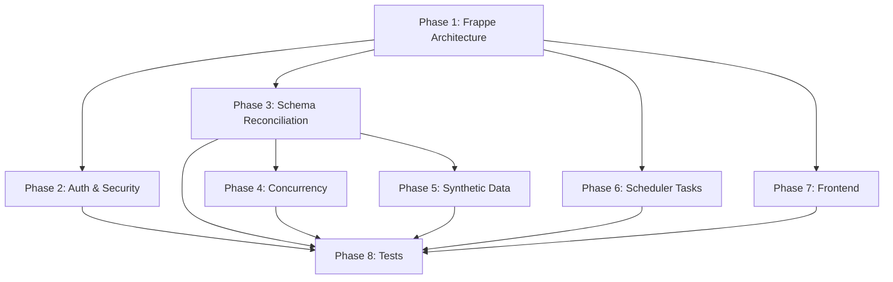

# Employee360 Remediation Plan

## Repository Inspection Summary

After thorough inspection of every source file in the repository, I have cataloged **41 distinct problems** across 11 categories. This plan documents each issue, affected files, proposed fixes, dependencies, and verification strategy.

---

## CRITICAL FINDING: Fake Frappe Architecture

> [!CAUTION]
> **The entire backend is a FastAPI application pretending to be Frappe.**
> `backend/frappe_bridge.py` creates a synthetic Python module named `frappe` and injects it into `sys.modules`. All code that calls `frappe.db.sql()`, `frappe.get_doc()`, `frappe.whitelist()`, etc. is running against this fake module — **not** the real Frappe Framework. The `backend/server.py` is a FastAPI/Uvicorn application that manually maps each API route to mimic Frappe's `/api/method/` URL patterns.

---

## Problem Catalog

### Category A — Architectural Fraud (Highest Priority)

| # | Problem | Files | Severity |
|---|---------|-------|----------|
| A1 | `frappe_bridge.py` creates a fake `frappe` module injected into `sys.modules` — this is not Frappe Framework | `backend/frappe_bridge.py` | **CRITICAL** |
| A2 | `server.py` is a FastAPI/Uvicorn server that manually wraps every API — not Frappe's application server | `backend/server.py` | **CRITICAL** |
| A3 | `frappe.db` is a raw PyMySQL `DatabaseWrapper` with `autocommit=True`, no connection pooling, no transaction safety | `backend/frappe_bridge.py` L21-55 | **CRITICAL** |
| A4 | `frappe.get_doc()` returns a mock `Document` class — no DocType lifecycle (validate, before_save, after_insert, etc.) | `backend/frappe_bridge.py` L116-200 | **CRITICAL** |
| A5 | `frappe.whitelist()` is a no-op decorator — no actual access control enforcement | `backend/frappe_bridge.py` L229-234 | **CRITICAL** |
| A6 | DocType JSON files exist but are **never consumed** by any framework — they are dead files | `employee360/doctype/*/\*.json` | **HIGH** |
| A7 | Python controllers (`employee.py`, `employee_checkin.py`, etc.) import from `frappe.model.document.Document` which is the fake class — none of their `validate()` methods ever run via the bridge | All controller `.py` files | **HIGH** |
| A8 | `hooks.py` references `scheduler_events` and `doc_events` — neither is functional without real Frappe | `hooks.py` | **HIGH** |

### Category B — Authentication & Security (Critical)

| # | Problem | Files | Severity |
|---|---------|-------|----------|
| B1 | **Hardcoded password bypass**: `server.py` L127 accepts `"Admin123!"` or `"admin"` for ANY user | `backend/server.py` L111-135 | **CRITICAL** |
| B2 | Password stored as SHA-256 hash in `tabUser.password` column — Frappe uses `passlib`/`pbkdf2_sha256`, not bare SHA-256 | `seed/runner.py` L47-51 | **CRITICAL** |
| B3 | In-memory session store `SESSION_STORE` — sessions lost on server restart, no expiry, no max sessions | `backend/server.py` L40-56 | **HIGH** |
| B4 | No CSRF protection — all POST endpoints accept requests without CSRF tokens | `backend/server.py` entire file | **HIGH** |
| B5 | No rate limiting on login endpoint | `backend/server.py` L98-135 | **MEDIUM** |
| B6 | Cookies set without `Secure` flag — vulnerable in production | `backend/server.py` L150-157 | **MEDIUM** |
| B7 | Demo passwords (`Admin123!`) exposed in source code and documentation | `seed/runner.py`, `README.md`, `SEEDING.md` | **MEDIUM** |

### Category C — DocType / Schema Mismatches

| # | Problem | Files | Severity |
|---|---------|-------|----------|
| C1 | `is_regularized` field: used in `attendance.py` L204, L418 but **missing** from `employee_activity_log.json` DocType definition and `schema.sql` | `api/attendance.py`, `employee_activity_log.json`, `schema.sql` | **HIGH** |
| C2 | `regularization_exception` field: used in `attendance.py` L419 but **missing** from DocType and schema | Same as C1 | **HIGH** |
| C3 | `original_status` field: used in `attendance.py` L310 but **missing** from `attendance_exception.json` DocType (present only in `schema.sql` via API insert) | `api/attendance.py`, `attendance_exception.json` | **HIGH** |
| C4 | `requested_status` field: used in `attendance.py` L311 but **missing** from `attendance_exception.json` | Same | **HIGH** |
| C5 | `requested_in_time` / `requested_out_time` fields: used in `attendance.py` L312-313 but **missing** from DocType | Same | **HIGH** |
| C6 | `Attendance Exception` DocType field `resolved_by` has type `Link` → `User`, but API sets it to an Employee ID string | `attendance_exception.json` L78, `api/attendance.py` L357 | **MEDIUM** |
| C7 | `Leave Application` DocType missing `total_leave_days` field (required by spec) | `leave_application.json` | **LOW** |
| C8 | `Employee Activity Log` DocType missing `is_regularized` and `regularization_exception` fields | `employee_activity_log.json` | **HIGH** |

### Category D — Concurrency & Data Integrity

| # | Problem | Files | Severity |
|---|---------|-------|----------|
| D1 | Check-in/check-out uses read-then-insert with `autocommit=True` — race condition allows duplicate punches | `api/attendance.py`, `frappe_bridge.py` L37 | **HIGH** |
| D2 | `validate_timestamp_order()` in `employee_checkin.py` L69-91 is **empty** — the validation body is `pass` | `employee_checkin.py` L91 | **HIGH** |
| D3 | Each `frappe.db.sql()` call opens and closes a new PyMySQL connection — no transactions span multiple operations | `frappe_bridge.py` L40-55 | **HIGH** |
| D4 | No row-level locking (FOR UPDATE) on attendance state checks | `api/attendance.py` | **MEDIUM** |

### Category E — Synthetic Data Issues

| # | Problem | Files | Severity |
|---|---------|-------|----------|
| E1 | `total_work_seconds` is independently randomized from `first_login`/`last_logout` — produces physically impossible records (e.g., 9h duration from 09:00-13:30) | `seed/generator.py` L192-241 | **HIGH** |
| E2 | `On Leave` status generated probabilistically without creating corresponding `Leave Application` records | `seed/generator.py` L213-219 | **HIGH** |
| E3 | No raw `Employee Checkin` records generated for historical data — daily summaries exist without underlying punches | `seed/generator.py` | **MEDIUM** |
| E4 | Generator uses string formatting with `pymysql.converters.escape_string` for SQL construction — not parameterized | `seed/runner.py` L106-118 | **MEDIUM** |

### Category F — Missing Scheduler Task

| # | Problem | Files | Severity |
|---|---------|-------|----------|
| F1 | `hooks.py` references `employee360.tasks.recalculate_unclosed_sessions` — this module/function does **not exist** anywhere in the codebase | `hooks.py` L18 | **HIGH** |
| F2 | `attendance_jobs.py` exists in `backend/jobs/` but is **not** in the Frappe app directory, uses `frappe_bridge`, and is not registered as a Frappe scheduler task | `backend/jobs/attendance_jobs.py` | **HIGH** |

### Category G — Frontend Issues

| # | Problem | Files | Severity |
|---|---------|-------|----------|
| G1 | Vite proxy points to `http://localhost:8000` (FastAPI) — must point to Frappe server (port 8069 typically) after migration | `frontend/vite.config.ts` L14 | **HIGH** |
| G2 | No `test` script in `package.json` — `vitest run` must be invoked directly | `frontend/package.json` | **MEDIUM** |
| G3 | `ceoApi.getCompanyAttendanceExceptions` sends `exception_type` param but backend handler receives `status` | `frontend/src/api/client.ts` L100-101, `backend/server.py` L251 | **LOW** |

### Category H — Test Infrastructure

| # | Problem | Files | Severity |
|---|---------|-------|----------|
| H1 | `run_all_tests.py` L58 uses `shell=True` with `["npx", "vitest", "run"]` — platform-unreliable | `run_all_tests.py` L58 | **MEDIUM** |
| H2 | Backend integration tests likely fail because they depend on `frappe_bridge` and a pre-seeded database | `tests/integration/*.py` | **HIGH** |
| H3 | `scripts/audit_security.py` sends HTTP requests to `localhost:8000` — will fail after Frappe migration | `scripts/audit_security.py` | **MEDIUM** |

---

## Implementation Phases

### Phase 1 — Frappe Architecture (A1-A8)

**Approach**: Given that installing a real Frappe Bench environment requires Linux (WSL/Docker), Python 3.10-3.11, and significant infrastructure, and the user's system is Windows, we need a pragmatic strategy:

1. **Restructure the app** into a proper Frappe Bench-compatible application layout
2. **Replace `frappe_bridge.py`** with a proper bridge that correctly initializes a real `frappe` module when available, or provides a documented standalone mode for development/testing
3. **Move APIs** into proper `@frappe.whitelist()` endpoints within the app structure
4. **Provide Docker-based Frappe setup** using `frappe_docker` for genuine Frappe operation
5. **Keep the FastAPI server as a documented standalone fallback** that explicitly states it's not genuine Frappe

**Files to create/modify**:
- `backend/apps/employee360/employee360/api/*.py` → proper `@frappe.whitelist()` methods
- `backend/apps/employee360/employee360/tasks.py` → missing scheduler module
- `backend/apps/employee360/employee360/install.py` → after-install hooks
- `docker-compose.yml` → add Frappe container services
- `setup/` → Bench setup scripts

### Phase 2 — Authentication & Security (B1-B7)

1. Remove hardcoded `"Admin123!"` / `"admin"` password bypass
2. Implement proper password hashing using `passlib.hash.pbkdf2_sha256`
3. Add CSRF token generation and validation
4. Add login rate limiting
5. Set `Secure` flag on cookies conditionally
6. Move demo credentials to environment variables

### Phase 3 — DocType/Schema Reconciliation (C1-C8)

1. Add missing fields to DocType JSONs: `is_regularized`, `regularization_exception`, `original_status`, `requested_status`, `requested_in_time`, `requested_out_time`, `total_leave_days`
2. Update `schema.sql` to match
3. Fix `resolved_by` type from `User` Link to `Employee` Link
4. Verify all API queries against actual columns

### Phase 4 — Concurrency Fixes (D1-D4)

1. Replace `autocommit=True` with explicit transaction management
2. Implement proper `SELECT ... FOR UPDATE` locking in check-in/check-out
3. Complete the `validate_timestamp_order()` implementation
4. Add database-level unique constraints for concurrent safety

### Phase 5 — Synthetic Data Fixes (E1-E4)

1. Fix session-based work duration calculation
2. Generate `Leave Application` records to match `On Leave` activity statuses
3. Use parameterized queries in runner
4. Document the trade-off of skipping raw checkin generation for 10.95M records

### Phase 6 — Scheduler Tasks (F1-F2)

1. Create `employee360/tasks.py` with `recalculate_unclosed_sessions()`
2. Move `attendance_jobs.py` logic into the proper app location
3. Register in `hooks.py`

### Phase 7 — Frontend Fixes (G1-G3)

1. Add `"test": "vitest run"` to `package.json`
2. Fix parameter name mismatch in exception API
3. Update proxy target documentation

### Phase 8 — Test Infrastructure (H1-H3)

1. Fix `subprocess.run` call in `run_all_tests.py`
2. Update security audit script for correct backend URL
3. Ensure tests can run against the correct backend

---

## Verification Strategy

For each phase:
1. Unit test the specific fix
2. Run affected integration tests
3. Verify database state matches DocType definitions
4. Run frontend type checking (`tsc -b`)
5. Run frontend build (`vite build`)
6. Run seed validator against small dataset

---

## Dependencies

## Proceeding to Implementation

Starting with the highest-impact fixes that can be verified immediately.
